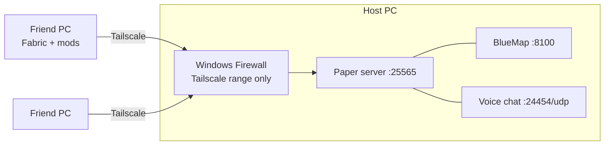

# NexusHost

Turn a Windows PC or laptop into a Minecraft Java server for you and your friends, even behind CGNAT, with no port forwarding and no tunnel service.

- **Paper** server, set up and updated by one script
- **Tailscale** for the connection: each friend joins your private network with their own free account, and you share only the server PC with them
- A **one-click `.bat` installer** for friends that sets up Fabric, performance mods, a minimap, shaders and voice chat, and adds the server to their Multiplayer list
- Server plugins: **BlueMap** (live 3D web map), **Simple Voice Chat**, **AxGraves**, **Chunky**



Tested with Minecraft 26.3, Paper build 253 and Fabric Loader 0.20.1 with 6-10 players on a laptop.

> **v2 note:** NexusHost v1 (Docker + Node hub/engine + Electron dashboard + Playit.gg/Localtunnel) was replaced by this simpler setup. It's still in the git history at commit `92983b4`.

## Requirements

- Windows 10 or 11 with 8 GB+ RAM free for the server
- [PowerShell 7](https://aka.ms/powershell): `winget install Microsoft.PowerShell`
- Java 25 for Minecraft 26.x: `winget install EclipseAdoptium.Temurin.25.JDK` (setup finds it and tells you if it's missing)
- [Tailscale](https://tailscale.com/download), signed in with your account

## Host quick start

```bash
git clone https://github.com/crimznexus/NexusHost
```

```bash
cd NexusHost
```

1. Copy `nexus.config.example.json` to `nexus.config.json` and set at least `serverName`, `memoryGB` and `iconText`. Leave `tailscaleHost` empty to use this PC's Tailscale IP automatically.
2. Download Paper, plugins and datapacks, and create `server\start.bat`:
   ```bash
   pwsh -File setup-server.ps1
   ```
   It asks you to accept the [Minecraft EULA](https://aka.ms/MinecraftEULA) the first time.
3. Open the ports to Tailscale only, from an **admin** PowerShell (once):
   ```bash
   pwsh -File scripts\firewall.ps1
   ```
4. Start the server with `server\start.bat`. In its console: `whitelist add <friend>` and `op <you>`.
5. Build the friend installer and join guide:
   ```bash
   pwsh -File build-installer.ps1
   ```
   Send `dist\Install-<Name>-Mods.bat` and `dist\FRIENDS-GUIDE.md` to your friends, plus a Tailscale share invite for each of them ([how](docs/HOSTING.md#sharing-the-server-with-friends-tailscale)).

Run `setup-server.ps1` again any time to update Paper and the plugins. Run `build-installer.ps1 -Resolve` to pick up newer client mods.

## What friends do

1. Install Tailscale, sign in, accept your share invite.
2. Close Minecraft and the launcher, double-click the installer.
3. Pick the new profile in the Minecraft Launcher and press Play. The server is already in Multiplayer.

The installer is a plain-text `.bat` (a PowerShell script inside), so anyone can read it in Notepad before running it. It downloads only from `cdn.modrinth.com` and checks every file's SHA-512 hash. It runs in Windows PowerShell 5.1, so friends don't need PowerShell 7.

## Repo layout

| Path | What it is |
|---|---|
| `nexus.config.example.json` | All settings: names, Minecraft version, RAM, plugins, ports |
| `setup-server.ps1` | Host setup and updates |
| `build-installer.ps1` | Builds the friend installer and guide into `dist\` |
| `mods/client-mods.txt` | The client mod list (edit this) |
| `mods/client-mods.lock.json` | Exact versions and hashes the installer uses |
| `scripts/` | Firewall, icon generator, mod resolver, dependency checker, headless test start |
| `templates/` | `start.bat`, the installer and the friends' guide templates |
| `docs/HOSTING.md` | Sharing, console commands, existing worlds, backups, troubleshooting |
| `docs/MODS.md` | What each mod and plugin does, and what to avoid |

`server\`, `dist\` and `nexus.config.json` are git-ignored: they hold your world, player list and Tailscale IP.

## Security notes

- The firewall rules accept connections only from Tailscale addresses (`100.64.0.0/10`), never from your local Wi-Fi or the internet.
- The server runs in online mode with the whitelist enforced.
- Tailscale node sharing gives friends access to the server PC only, not your other devices.
